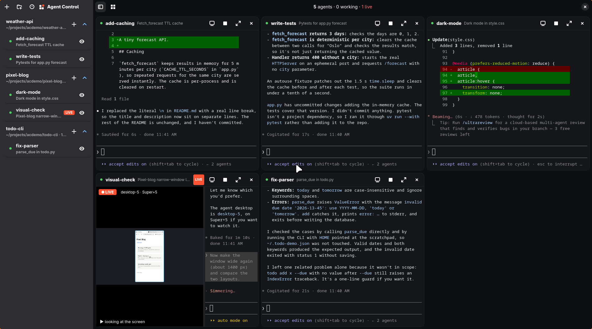
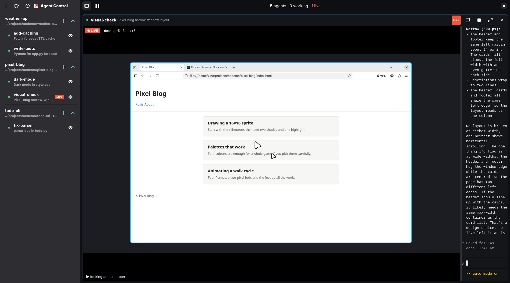

<p align="center">
  <picture>
    <source media="(prefers-color-scheme: dark)" srcset="docs/logo/lockup-animated-dark.svg">
    
  </picture>
</p>
<p align="center">V1 Free and Open Source</p>
<p align="center">
  <b>Every <a href="https://docs.anthropic.com/en/docs/claude-code">Claude Code</a> agent at a glance.</b><br>
  Watch them work, type into any of them, and see their desktops live.
</p>

<p align="center">
  <a href="#install">Install</a> ·
  <a href="#use">Use</a> ·
  <a href="#live-desktop-streams-optional">Live streams</a> ·
  <a href="#for-agents">For agents</a> ·
  <a href="#how-it-works">How it works</a>
</p>

<p align="center">
  
</p>

Agent Control runs your agents as Claude Code sessions in a dedicated tmux server and shows each one as a
tile: its terminal, which you type into directly, and (optionally) a live stream of the agent's own desktop
while it uses one. A tmux-like grid puts several agents on one screen, projects group them in the sidebar,
and a token panel shows what they cost.

Native GTK 4 / libadwaita + VTE, written in Python. Linux only.

- **Tiles**: each agent's Claude Code terminal (type straight into it) and its state, working or idle. Focus one, or grid them in auto / 1–4 columns.
- **`ac` CLI**: start, message, read and wait for agents from any shell, including from another agent.
- **Projects**: named working directories. Agents are grouped by the project they run in.
- **Live desktop streams**: with [hypr-computer](#live-desktop-streams-optional) agent desktops, a tile streams the agent's screen with its last action as a ticker.
- **Token usage panel**: the [TokenTracker](https://github.com/xiufengsun/TokenTracker) dashboard beside your agents: usage and cost per day, model, project and session, plus subscription limits.

Agents keep running when the window closes; `ac attach NAME` puts any terminal into an agent's session.

<p align="center">
  
  <br><sub>Focus an agent to watch its desktop full size while you read along in its terminal.</sub>
</p>

## Requirements

- Linux with a Wayland or X11 desktop
- [Claude Code](https://docs.anthropic.com/en/docs/claude-code) (`claude` on PATH, logged in)
- tmux
- Python 3.10+ with PyGObject, GTK 4, libadwaita ≥ 1.5 and VTE for GTK 4 (`Vte 3.91`). Use your
  distribution's packages: PyGObject can't come from pip without building GTK bindings.

| Distro | Install |
|---|---|
| Fedora | `sudo dnf install tmux python3-gobject gtk4 libadwaita vte291-gtk4` |
| Debian / Ubuntu (24.04+) | `sudo apt install tmux python3-gi gir1.2-gtk-4.0 gir1.2-adw-1 gir1.2-vte-3.91` |
| Arch | `sudo pacman -S tmux python-gobject gtk4 libadwaita vte4` |

Optional, for the token panel: WebKitGTK 6.0 (Fedora `webkitgtk6.0`, Debian/Ubuntu `gir1.2-webkit-6.0`, Arch
`webkitgtk-6.0`) and Node.js 20+ (`npx`) or a global `tokentracker`.

## Install

```sh
git clone https://github.com/zinoos/agent-control.git ~/projects/agent-control
cd ~/projects/agent-control
./install.sh            # links ac + agentcontrol into ~/.local/bin, adds the app-launcher entry and icon
./install.sh --skill    # same, plus the agent-control skill for Claude Code (~/.claude/skills)
```

The installer only creates symlinks into the checkout (`git pull` updates everything) and reports missing
dependencies. `./install.sh --uninstall` removes them. You can also run `bin/agentcontrol` and `bin/ac`
straight from the checkout.

Or with npm (Linux, Node 18+). It puts `agentcontrol` and `ac` on your PATH and prints what's still missing:

```sh
npm i -g agentcontrol
```

npm can't install the GTK bindings, tmux or Claude Code, so those still come from your distro and the
[Requirements](#requirements) above. An npm install has no git checkout, so it doesn't get the update button.

When you run from a git checkout (`install.sh` or `bin/agentcontrol`), the app checks `origin/master` every 30
minutes. If it's behind, an **Update** button appears in the header. Clicking it fast-forwards the checkout
(`git merge --ff-only`) and asks you to restart. It never touches local commits: a branch with its own commits
gets no button. Set `AGENTCONTROL_NO_UPDATE_CHECK=1` to turn the check off.

## Use

```sh
agentcontrol                     # the app (also in the app launcher)
ac new [NAME] [-P PROJECT] [-C DIR] [-p "first instruction"] [-- claude args]
ac ls                            # agents by project: state, desktop, LIVE
ac projects                      # project presets
ac project add NAME [DIR]        # DIR defaults to ~/projects/<name>; created if missing
ac project rm NAME               # forget the preset (files and agents stay)
ac send NAME "do X next"         # message an agent (queued by Claude Code while it works)
ac peek NAME [-n 40]             # the end of its screen as text
ac wait NAME [-t 600]            # block until it's idle (idle / ended / timeout)
ac attach NAME                   # this terminal into the agent's session (tmux)
ac stop NAME                     # Esc: interrupt
ac kill NAME
```

For example:

```sh
ac project add my-app ~/code/my-app
ac new fix-tests -P my-app -p "Run the test suite, fix what fails, and summarize what you changed."
ac wait fix-tests -t 900 && ac peek fix-tests -n 60
```

In the app:
- **Projects**: the sidebar groups agents by project, one collapsible section each. A project is a name
  plus the directory its agents start in. The **+** on a project starts an agent there. Right-click a
  project: open folder, edit, remove. Agents outside every project go under **Other**
- **folder button / Ctrl+Shift+N**: new project. The directory follows the name (`~/projects/<name>`)
  until you change it, and is created if it doesn't exist
- **+ / Ctrl+N**: new agent (project, name, directory, first instruction)
- **Clock button / Ctrl+Shift+R**: resume a past Claude Code session. Search your recent sessions by title,
  prompt or folder and pick one: it continues in a new agent (`claude --resume`) in its original folder. A
  session that's still running is focused instead (or reported, if it runs in another terminal)
- **Click** an agent in the sidebar, or double-click a tile header: focus it; again (or **Ctrl+G**): back to the grid
- **Alt+1…9**: focus tile N. **Sidebar button** (top left of the grid) **/ Ctrl+B**: hide or show the agent list
- **Ctrl+Shift+T**: the token usage panel (see below). Drag the divider to resize
- **Grid button**: auto grid or a fixed 1-4 columns. The eye button hides or shows an agent in the grid
- Per tile: **Stop** = Esc, **×** hides the tile (the session keeps running). With streams available, the
  **video button** cycles auto / stream / terminal
- **Gear button / Ctrl+,**: settings, applied right away
  - *Appearance*: window opacity (the blur behind it comes from your compositor, e.g. Hyprland's
    `decoration:blur`), accent color, gap and corner radius of the tiles, terminal font and color scheme
    (agentControl, Catppuccin Mocha, Tokyo Night, Gruvbox Dark, or the colors from your kitty.conf)
  - *Agents*: folder for new projects, extra `claude` arguments for every new agent (also for `ac new`),
    a desktop notification when an agent finishes while the window isn't focused, asking before ending a session
  - *Panels*: default tile view and max fps for streams, whether the token panel opens at start, the
    TokenTracker command
- Type straight into a tile's terminal; `ac send` messages an agent from any shell

Only sessions started through Agent Control (`ac new`, the + button or resume) appear; a `claude` started in
a plain terminal doesn't.

## Configuration

Everything works without configuration. Files and environment variables, all optional:

| What | Default | Purpose |
|---|---|---|
| `~/.config/agentcontrol/projects.json` | created empty | project presets (edited from the app or `ac project`) |
| `~/.config/agentcontrol/settings.json` | created by the Settings dialog | settings (also read by `ac`) |
| `~/.local/state/agentcontrol.json` | | window state: hidden tiles, columns, panel width |
| `AGENTCONTROL_PROJECTS_DIR` | `~/projects` | where new projects go when no directory is given, until set in Settings |
| `AGENTCONTROL_FONT` | `monospace 10` | terminal font until one is picked in Settings (Pango syntax, e.g. `JetBrains Mono 11`) |
| `AGENTCONTROL_PYTHON` | `/usr/bin/python3` | the Python that has PyGObject |
| `AGENTCONTROL_TOKENTRACKER` | `tokentracker`, else `npx -y tokentracker-cli@latest` | command for the token panel, until set in Settings |
| `HYPR_COMPUTER_SRC` | `../hypr-computer/src` next to this repo | where to find hypr-computer for streams |

`projects.json` looks like this:

```json
{
  "projects": [
    { "name": "my-app", "path": "~/code/my-app" },
    { "name": "website", "path": "~/projects/website" }
  ]
}
```

## Tests

```sh
dbus-run-session -- python3 -m unittest discover -s tests -t . -v
```

The tests use their own HOME, settings and tmux server and a fake `claude`, so they never touch your agents.
The GUI tests need a display (they're skipped without one). Run them before every push (see `AGENTS.md`);
`.github/workflows/tests.yml` runs the same suite in a Fedora container under Xvfb where GitHub Actions is on.

## Token usage panel

**Ctrl+Shift+T** opens the [TokenTracker](https://github.com/xiufengsun/TokenTracker) dashboard on the
right: token and cost trends, models, projects, sessions and subscription limits across Claude Code, Codex,
Cursor, OpenCode and 40-odd other clients. It's parsed from your local logs; nothing is uploaded unless you
opt into TokenTracker's cloud sync or leaderboard. Links that leave the dashboard open in your browser, and
the panel's browser button opens the dashboard itself there.

If a TokenTracker server is already running on `127.0.0.1:7680` (its desktop app, or `tokentracker serve`),
the panel uses it. Otherwise it starts `tokentracker serve --no-open` from your PATH, or
`npx -y tokentracker-cli@latest serve --no-open` if Node is installed (`npm i -g tokentracker-cli` makes it
start faster), and stops it again when Agent Control quits. On its very first run TokenTracker sets itself
up: it scans all your logs and adds its sync hooks to the tools it finds (for Claude Code, a `SessionEnd`
hook in `~/.claude/settings.json`). Run `tokentracker init` yourself beforehand to see and confirm that,
and `tokentracker uninstall` to undo it.

## Live desktop streams (optional)

Agent Control can show what an agent sees when it uses a computer-use MCP server that gives each agent its
own desktop: [hypr-computer](https://github.com/zinoos/hypr-computer), a Hyprland MCP server where each
agent gets a nested Hyprland session. Without it, tiles show terminals only and the stream controls are
hidden.

To enable streams, install hypr-computer (its README covers the MCP setup) and check it out next to this
repo, or point `HYPR_COMPUTER_SRC` at its `src/` directory:

```sh
git clone https://github.com/zinoos/hypr-computer.git ~/projects/hypr-computer   # next to agent-control
```

The contract, if you want to plug in a different desktop provider:

- each agent desktop writes `$XDG_RUNTIME_DIR/hypr-computer/<name>.json` with
  `{"name", "pid", "wl_socket", "width", "height", "place", "accent", "owner_pid"}`, where `owner_pid` is
  the MCP server process (a descendant of the agent's Claude Code session)
- after each action it writes `<name>.activity` with `{"t": unix_time, "text": "what it did"}`. The tile
  shows LIVE for 45 s after the last one
- frames are read with wlr-screencopy from `wl_socket`, using `hypr_computer.wlvirt`

## For agents

`./install.sh --skill` links `skill/` as the `agent-control` Claude Code skill, so your agents can start
and follow up on other agents with `ac` when you ask them to. It covers when to start agents (only on
request), how to write a self-contained first instruction, and how to follow up with
`ac wait` / `ac peek` / `ac send`. For other coding agents (Codex, opencode, …), point their instructions
file at the same `ac` commands.

## How it works

- Agents are Claude Code processes in their own tmux server (`tmux -L agentcontrol`, config `tmux.conf`).
- A tile's terminal is a VTE running `tmux attach`. `ac send` uses tmux bracketed paste + Enter, which
  Claude Code queues while it's working.
- State (working / idle) comes from the terminal title Claude Code sets (spinner vs ✳).
- An agent started for a project is tagged with the tmux session option `@ac_project`. An untagged agent
  (say `ac new -C ~/code/my-app/api`) goes under the project whose directory contains its start directory,
  the most specific one.
- Streams capture only while visible, using damage-driven frames (idle screens cost ~nothing). They are
  capped at 30 fps, or 15/8 fps in crowded grids.

## License

[MIT](LICENSE). The logo files are in [`docs/logo`](docs/logo).
